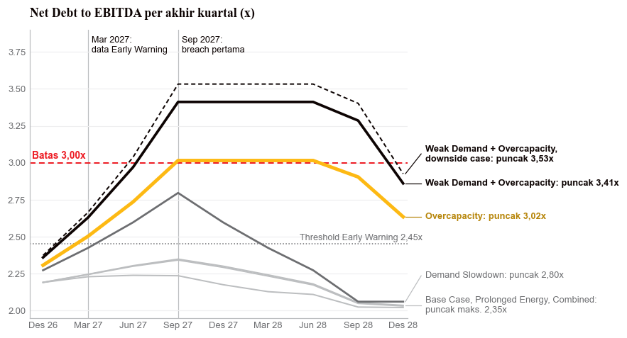

# Ketahanan *Covenant* dan Likuiditas SMDR terhadap Siklus *Freight Rate*

*Scenario-based stress test and backtest of covenant compliance and liquidity at PT Samudera Indonesia Tbk, 2026–2031, built only from public data.*

Penelitian independen dengan data publik per 30 September 2026. Seluruh angka, data, kode, model Excel, dan naskah dapat direplikasi dari repositori ini.

## Pertanyaan dan jawaban

**Seberapa besar penurunan tarif yang dapat ditanggung SMDR sebelum *covenant* dan likuiditasnya tertekan, dan *covenant* mana yang tertekan lebih dahulu?**

- **Tekanan terkonsentrasi pada *covenant leverage*.** Penurunan tarif efektif 12% (setara FY2024) membawa *Net Debt to EBITDA* dari 2,14x ke **3,02x** (batas 3,00x), dan **3,41x** bila disertai penurunan volume 5%. *Breach* pertama jatuh pada pengujian **Sep 2027**.
- **DSCR, *Current Ratio*, dan kas tetap memenuhi pada asumsi tengah** (DSCR terendah 1,32x, *Current Ratio* terendah 1,33x, kas + deposito terendah USD 193 juta). Pada *downside case* arus kas, *Current Ratio* menembus 1,10x pada Des 2028 dan kas menembus batas minimum pada Jun 2029, yaitu 15 dan 21 bulan setelah *breach* pertama.
- ***Headroom* penurunan tarif 11,8%** sebelum 3,00x; 15,7% dan 22,5% bila dampak nyata seperti FY2024 dan FY2023. *Backtesting* FY2023–FY2025: prediksi model 1,9× dan 1,3× dampak aktual, dan sama pada FY2025.
- ***Early Warning*:** threshold 2,45x pada data Mar 2027 memisahkan skenario yang kelak *breach* (2,63x dan 2,50x) dari yang tidak (≤ 2,42x), enam bulan sebelum pengujian pertama. Ini usulan *in-sample* yang perlu dikalibrasi ulang dengan data internal.



Hasil bersifat pro forma atas posisi 30 September 2026 (belum diaudit). Ia bukan proyeksi, ramalan, atau pernyataan probabilitas.

## Isi repositori

| Bagian | Isi |
|---|---|
| [`notebooks/paper.ipynb`](notebooks/paper.ipynb) · [`paper.html`](notebooks/paper.html) | Naskah gaya artikel jurnal: 17 persamaan bernomor, 14 tabel, 6 gambar. Angka pada teks dihitung dari data saat naskah dibangun |
| [`model/SMDR_Financial_Model.xlsx`](model/SMDR_Financial_Model.xlsx) | Financial model berumus hidup di atas laporan keuangan; 6 skenario × 2 kasus; dicocokkan sel per sel dengan model Python ([README](model/README.md)) |
| [`deck_v5/out/`](deck_v5/out/) | Delapan slide presentasi (PNG) dan sumbernya |
| [`deck_v5/export/`](deck_v5/export/) | Deck terpadu: PPTX dan PDF (slide berupa gambar, tidak dapat disunting) |
| [`data/`](data/README.md) | Data teks terbuka berlapis: `00_registry` → `01_raw` → `02_curated` → `03_canonical` → `04_marts` |
| [`src/smdr/`](src/smdr/) | Kode: ingest, kontrol mutu, model transmisi, kas, covenant, mitigasi, ketahanan, registri |
| [`tests/`](tests/) | Uji unit, kontrak data, jejak mentah ke kanonik, kecocokan Excel, dan naskah |
| [`docs/`](docs/) | [Perlakuan data](docs/data-treatment.md), [model card](docs/model-card.md), keputusan arsitektur ([ADR](docs/adr/)) |

## Mulai cepat

```bash
python -m venv .venv && source .venv/bin/activate
pip install -r requirements.txt
PYTHONPATH=src python -m unittest discover -s tests     # uji
make paper                                               # bangun ulang naskah dari data
```

`make all` membangun ulang seluruh rantai (data → deck → registri → Excel → naskah → uji).

### Tingkat reproduksi

| Tingkat | Butuh | Yang dapat dibangun ulang |
|---|---|---|
| 1. Hasil dari data teks | repositori ini | marts, deck, naskah, registri, sebagian besar uji |
| 2. Dari laporan keuangan | + `Financial-Statements/SMDR_Financial_Statements_2021_9M26.xlsx` (disertakan) | `01_raw/idx` dan `03_canonical/fs_long`, model Excel (verifikasi rumus butuh LibreOffice) |
| 3. Dari dokumen sumber | + PDF Annual Report, prospektus, dan berkas Excel IDX (tidak disertakan) | verifikasi hash dokumen dan token halaman |

Uji yang bergantung pada dokumen sumber dilewati (bukan gagal) bila dokumennya tidak ada.

## Data dan lisensi

Kode berlisensi [MIT](LICENSE). Data berasal dari sumber publik dengan atribusi pada [`data/00_registry/sources.csv`](data/00_registry/sources.csv). Dokumen sumber (Annual Report, prospektus, laporan riset, berkas Excel IDX) **tidak** dipublikasikan; yang tersedia hanya manifes beserta hash dan halaman rujukannya, serta nilai yang diekstraksi per butir. Dua sumber berstatus **perlu verifikasi** untuk redistribusi (Drewry WCI dan seri kurs penyedia); periksa kolom `redistribution` sebelum memakai ulang.

## *Disclaimer*

Dokumen ini adalah riset mandiri dan bukan dokumen resmi PT Samudera Indonesia Tbk maupun entitas anaknya. Isinya bukan nasihat hukum, akuntansi, perpajakan, investasi, maupun kredit. Rincian keterbatasan ada pada naskah (Bab 8) dan slide Disclaimer.

## Sitasi

Lihat [`CITATION.cff`](CITATION.cff).
